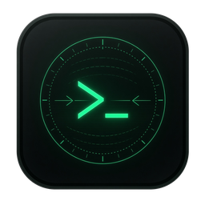
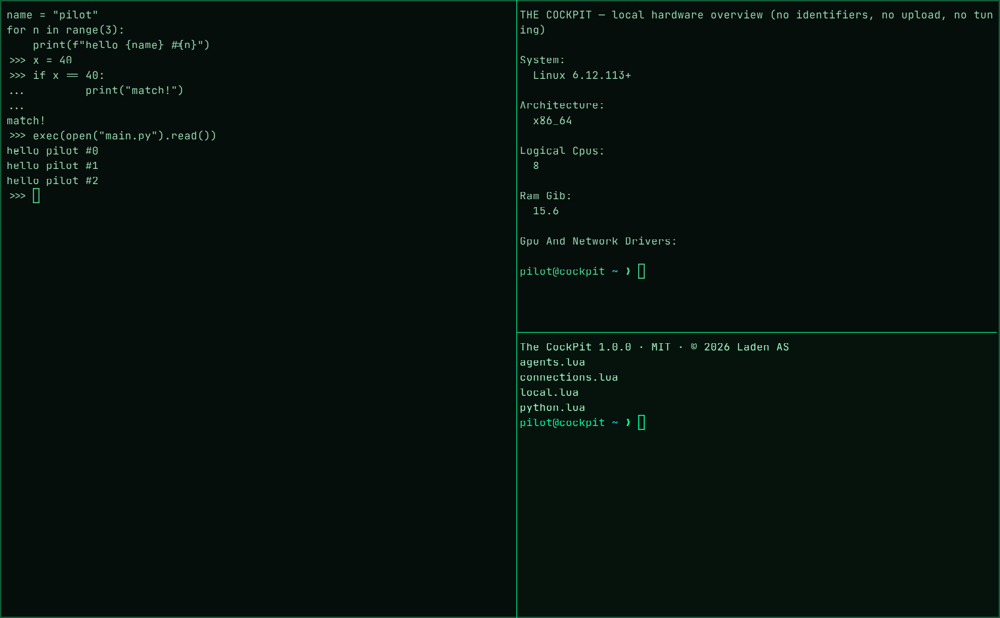
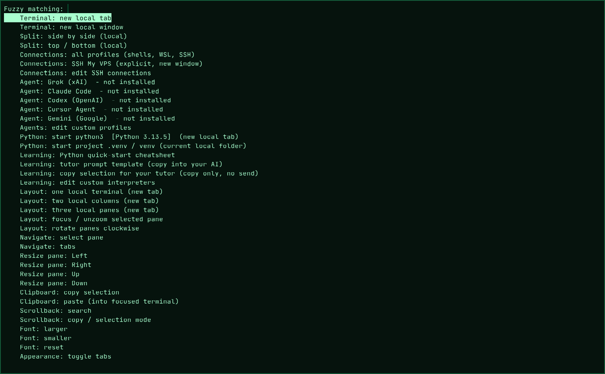

<p align="center">
  
</p>

<h1 align="center">The CockPit</h1>

<p align="center">
  An emerald terminal cockpit for Linux, Windows and macOS, built on WezTerm.<br>
  Free and open source. © 2026 Laden AS, released under the MIT License.
</p>



## What it is

The CockPit turns [WezTerm](https://wezterm.org/) into a calm, green, frameless
terminal with everything one right-click away. It is local-first: nothing connects,
signs in, uploads or starts a task unless you pick it.

## Features

- **Emerald look.** A green-on-black theme, frameless window with thin borders, JetBrains Mono, slight transparency.
- **One menu for everything.** Right-click, F12 or Ctrl+Alt+Space opens a searchable menu with
  tabs, splits, three ready-made layouts, pane navigation and resizing, clipboard,
  scrollback search, font size, transparency, title bar, window size and fullscreen.
- **fish by default.** fish is used when it's installed. Otherwise you get your login shell on Linux/macOS, and PowerShell, WSL and
  Command Prompt profiles on Windows.
- **Python learning.** It finds your Python interpreters, opens a REPL in one click, starts the
  `.venv` of the folder you are in, and includes a cheatsheet for the most common syntax
  errors and a tutor prompt you can give any AI.
- **Bring your own AI.** If you have installed and logged into Grok, Claude Code, Codex,
  Cursor Agent or Gemini on the command line, they show up in the menu, plus a
  "Python + AI tutor side by side" layout. Add your own tools in `agents.lua`. The CockPit never
  installs, signs in to or sends anything to an AI service.
- **Explicit SSH.** Your servers go in `connections.lua`. Agent and X11 forwarding are always off, and a new host
  key has to be confirmed. No keys or passwords are stored.
- **Hardware overview.** A read-only, privacy-filtered summary of CPU, RAM, GPU/network
  drivers and OpenGL renderer that never prints identifiers or changes settings.



## Install

Downloads: <https://laden.no/portefolje/the-cockpit/> and the GitHub releases page.
Check the files against `SHA256SUMS`.

| Platform | File | How |
| --- | --- | --- |
| Linux (x86_64) | `the-cockpit-1.0.0-linux-x86_64.tar.gz` | `tar -xzf the-cockpit-1.0.0-linux-x86_64.tar.gz && cd the-cockpit-1.0.0-linux-x86_64 && ./install.sh` |
| Linux (x86_64) | `TheCockPit-1.0.0-x86_64.AppImage` | `chmod +x TheCockPit-1.0.0-x86_64.AppImage && ./TheCockPit-1.0.0-x86_64.AppImage` |
| Debian/Ubuntu/Kali | `the-cockpit_1.0.0_all.deb` | `sudo apt install ./the-cockpit_1.0.0_all.deb`, plus WezTerm from [its APT repo](https://wezterm.org/install/linux.html) |
| Windows 10/11 (x64) | `TheCockPit-1.0.0-windows-x64.zip` | Unzip, then right-click `install.ps1` and choose **Run with PowerShell**, or double-click `Start-TheCockPit.cmd` to run it portable |
| macOS 10.12+ (Apple Silicon & Intel) | `TheCockPit-1.0.0-macOS-universal.zip` | Unzip, drag **The CockPit.app** to Applications, and right-click it and choose **Open** the first time |

The tarball, AppImage, Windows and macOS packages bundle the official, unmodified WezTerm
`20240203-110809-5046fc22` release, so there is nothing else to install. On Linux,
`install.sh` uses a WezTerm you already have and only unpacks the bundled one if needed
(`--bundled` / `--no-bundled` override this). The `.deb` is small and expects WezTerm
from WezTerm's own APT repository.

**From source.** With WezTerm installed, run `bin/cockpit` on Linux/macOS or
`bin/cockpit.ps1` on Windows. They start
`wezterm --config-file config/cockpit.lua start --class the-cockpit`.

Optional extras: [fish](https://fishshell.com/), Python 3, OpenSSH, WSL on Windows, and
any AI command-line tools you like.

## Use

| Keys | Action |
| --- | --- |
| Right-click / F12 / Ctrl+Alt+Space | CockPit menu (type to filter). Hold Shift in mouse-using apps like vim |
| Ctrl+Shift+D / E | split top-bottom / side by side |
| Ctrl+Shift+T / N | new tab / new window |
| Ctrl+Shift+W | close pane (asks first) |
| Ctrl+Shift+arrows | move between panes |
| Ctrl+Shift+P | all profiles: shells, WSL, SSH |
| Ctrl+Shift+left-drag | move the frameless window |

Command line: `cockpit`, `cockpit --ssh myserver`, `cockpit --hardware`, `cockpit -- htop`.

Your settings live outside the app, so updates never touch them. On Linux and macOS they are in
`~/.config/the-cockpit/`, and on Windows in `%APPDATA%\TheCockPit\`. They are:
`connections.lua` (SSH), `agents.lua` (extra tools), `python.lua` (extra interpreters) and
`local.lua` (any WezTerm setting, e.g. `window_decorations = "TITLE|RESIZE"` or
`enable_wayland = false`). See [docs/GUIDE.md](docs/GUIDE.md).

## Platform notes

- **Linux.** Works on X11 and Wayland. If the window misbehaves on a Wayland compositor, set
  `enable_wayland = false` in `local.lua`. Global hotkeys (e.g. Alt+Q to open a CockPit)
  belong in your desktop's keyboard settings; point them at `cockpit`.
- **Windows.** The fish/bash features run inside WSL. The native default is PowerShell.
  The files are not code-signed, so SmartScreen may ask once.
- **macOS.** The app is not notarized, so right-click it and choose **Open** the first time. The Dock shows
  the WezTerm engine icon while it runs.

## Build the packages

```sh
python3 scripts/build-dist.py   # needs vendor/ assets, see the script header
sh scripts/check.sh             # shellcheck, Lua config parse, unit tests
```

## Credits and license

The CockPit is © 2026 Laden AS, released under the [MIT License](LICENSE).

Built on **[WezTerm](https://github.com/wez/wezterm)** by Wez Furlong (MIT License).
The packages bundle WezTerm unmodified. Its license and the licenses of the fonts it
embeds are in [`licenses/`](licenses/) and summarized in
[THIRD_PARTY_NOTICES.md](THIRD_PARTY_NOTICES.md).

The name "The CockPit", the icon and the Laden brand belong to Laden AS. Made in Oslo by
[Laden AS](https://laden.no/).
